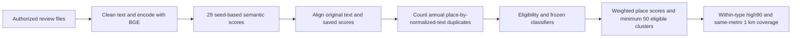
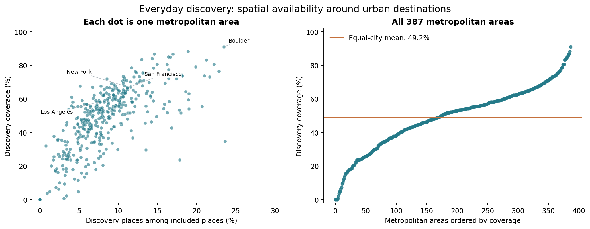
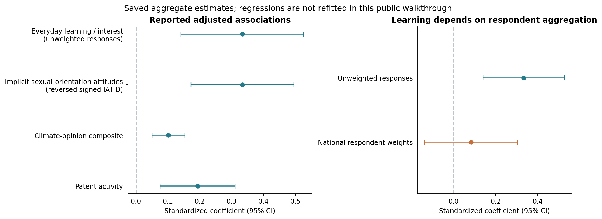

# Urban discovery: semantic analysis, review processing and selected results

## Research question

Where do everyday urban places offer opportunities for exploration, discovery and learning, and how does their spatial availability relate to cities' intellectual and social life?

The project analyzed Google Maps reviews posted in 2019 for **382,361 eligible places across 387 U.S. metropolitan areas and 34 broad venue types**. This repository exposes the actual text-analysis methods and selected archived results from this ongoing study. It includes **all 29 original semantic seed banks (275 prototype-sentence entries)**, the frozen text-feature policies and classifier program chain, annual duplicate-weighted aggregation, and spatial coverage code.

## Start with the executed notebooks

- **[Methods walkthrough — executed](notebooks/METHODS_WALKTHROUGH_EXECUTED.ipynb):** reads the actual seed definitions and shows the original semantic-scoring, filtering, classification and aggregation functions. It performs source inspection without loading an encoder or processing reviews.
- **[Selected results — executed](notebooks/SELECTED_RESULTS_EXECUTED.ipynb):** displays the existing metropolitan-pattern figure and redraws saved aggregate estimates. It does not fit new models.

## How the text pipeline works



The historical encoder uses `BAAI/bge-large-en-v1.5`. For 27 dimensions, the direction is the positive-seed mean minus the negative-seed mean; the two SPANE dimensions use one seed centroid. The code retains the original cleaning, seed encoding, half-precision review encoding, 256-token review limit and cosine scoring. The eligibility policy and review classifier are separate stages. Exact normalized-text multiplicity is counted across the annual sources before eligibility filtering; positive eligible weighted mass is divided by eligible weighted mass.

The original numerical computation is retained. Institutional paths and automatic encoder launch were replaced by explicit arguments in `semantic_analysis.py`. The alignment, enrichment, scorer-version chain, annual aggregation and spatial functions are complete, byte-for-byte copies of their bound source files. [METHOD_SOURCE_MAP.json](METHOD_SOURCE_MAP.json) records this distinction and the source hashes.

## Source reading order

| Stage | Actual source |
|---|---|
| Actual seed definitions, cleaning, centroid construction, encoder call and chunk processing | [semantic_analysis.py](code/review_pipeline/semantic_analysis.py) |
| Original text–score alignment and row-key checks | [align_state_year_reviews.py](code/review_pipeline/align_state_year_reviews.py) |
| Normalization, identity checks and complete-corpus duplicate accounting | [enrich_and_deduplicate_corpus.py](code/review_pipeline/enrich_and_deduplicate_corpus.py) |
| Six text-context features and the exact generic-content flag | [text_context_features_v1_1.py](code/review_pipeline/text_context_features_v1_1.py) |
| Attachment-specific feature policy | [t05_structural_features_v1_2.py](code/review_pipeline/t05_structural_features_v1_2.py) |
| Final scorer entry point, inherited version contracts and numerical predictor | [score_multitarget_v1_2_7.py](code/review_pipeline/score_multitarget_v1_2_7.py), [v1.2.2 numerical scorer](code/review_pipeline/score_multitarget_v1_2_2.py), [base CLI](code/review_pipeline/score_multitarget_v1_1.py) |
| Full annual aggregation and receipts | [aggregate_annual_four_targets.py](code/review_pipeline/aggregate_annual_four_targets.py) |
| National within-type midpoint ranks, same-metro distance and self exclusion | [spatial_coverage.py](code/review_pipeline/spatial_coverage.py) |

[METHODS_AND_INPUTS.md](METHODS_AND_INPUTS.md) explains the input contracts, source lineage and historical operational details. The earlier representative estimation and display functions remain in `code/`.

## Representative archived results



Each dot is one metropolitan area. This unchanged figure uses actual study aggregates; the city-level source frame remains private.



These are saved adjusted associations and confidence intervals, not new estimates. The attitude measure is a sexual-orientation IAT with its sign reversed. Learning is sensitive to the survey respondent-aggregation choice: its interval includes zero under national respondent weights. These are associations rather than estimated intervention effects.

## Run the public walkthroughs

Tested with Python 3.13:

```bash
python3 -m venv .venv
source .venv/bin/activate
python -m pip install -r requirements.txt
python scripts/execute_methods.py
python scripts/execute.py
```

The first command executes source inspection and refreshes `METHODS_WALKTHROUGH_EXECUTED.ipynb`; the second refreshes the existing saved-result notebook and figure. Neither command requests embeddings, calls a language-model service or reads private study data.

To use the processing programs with separately authorized inputs, install the optional dependencies in `requirements-methods.txt` and inspect their CLI arguments, for example:

```bash
python code/review_pipeline/semantic_analysis.py --help
python code/review_pipeline/align_state_year_reviews.py --help
python code/review_pipeline/score_multitarget_v1_2_7.py --help
```

Actual classification additionally requires the external frozen fitted artifact; aggregation requires its source manifests and receipts. These files are not distributed. The public walkthrough does not recreate the full study or certify bitwise historical execution.

## Public scope

Included: original method code, actual prototype seeds, fixed text dictionaries and rules, source hashes, selected previously published aggregate figures and estimate tables, and executed walkthroughs. No review text, reviewer or venue identifiers, row-level city or survey frames, learned classifier weights, centroid arrays, manuscripts, credentials or private execution logs are included. Field names used by the original code are retained; no actual identifier values are supplied.

`PUBLIC_FILES.json` is the closed file manifest. The existing source files, MAIN and archived results are preserved. No additional rights in the underlying study data are granted by this code sample.
